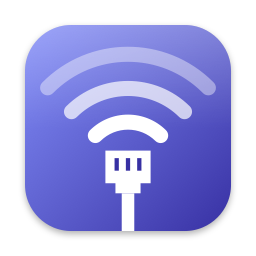
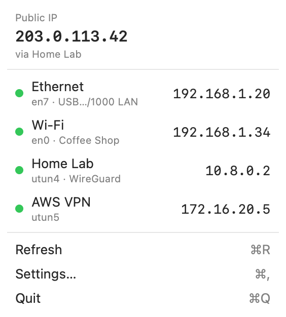
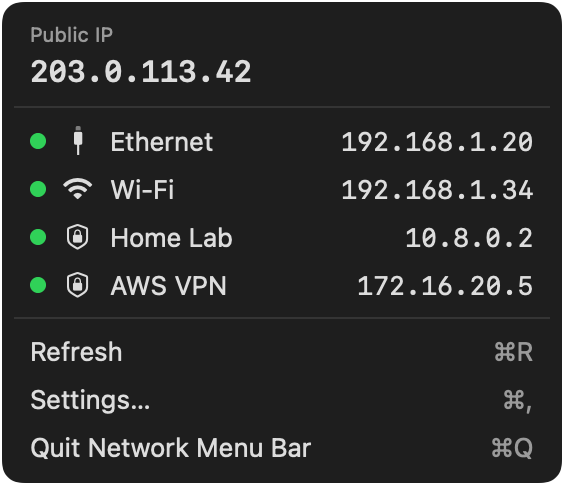

<p align="center">
  
</p>

<h1 align="center">Network Menu Bar</h1>

<p align="center">
  Your Ethernet, Wi‑Fi and VPN status — and every IP address that matters — one click away in the macOS menu bar.
</p>

<p align="center">
  
  
  
</p>

<p align="center">
  
  &nbsp;&nbsp;
  
</p>

## Features

- **Its own menu bar icon** — never mistaken for the system Wi‑Fi icon, and dimmed when you're offline.
- **Public and private IPs** — your public IP on top, then the private IPv4 of every network, each with an Ethernet, Wi‑Fi or VPN icon. Click any of them to copy it.
- **VPN aware** — detects WireGuard and OpenVPN Connect tunnels by name, plus OpenVPN connections from Tunnelblick and AWS VPN Client.
- **Knows where your traffic goes** — the detailed layout shows which network your public IP exits through, even with split‑tunnel VPNs.
- **Updates itself** — reacts instantly when you plug a cable, switch Wi‑Fi or connect a VPN. No polling.
- **Compact or detailed** — pick the layout, hide the network icons, and optionally show the public or private IP next to the menu bar icon.
- **Native and lightweight** — SwiftUI, no dependencies, no Dock icon. Launches at login.
- **English and Spanish.**

## Requirements

macOS 14 Sonoma or later.

## Installation

### Download

1. Download the latest `Network-Menu-Bar-x.y.z.dmg` from [Releases](https://github.com/kijart/network-menu-bar/releases). Optionally, download `Network-Menu-Bar-x.y.z.dmg.sha256` next to it and verify the download with `shasum -a 256 -c Network-Menu-Bar-x.y.z.dmg.sha256`.
2. Open it and drag **Network Menu Bar.app** to the Applications folder.
3. Allow the first launch:
   - **macOS 15 or later**: open the app once, then go to **System Settings → Privacy & Security** and click **Open Anyway**, then confirm.
   - **macOS 14**: right‑click the app, choose **Open** and confirm.

> [!NOTE]
> Network Menu Bar is ad‑hoc signed and not notarized by Apple, so Gatekeeper asks for confirmation on first launch. If macOS says the app is damaged or can't be opened, clear the quarantine flag:
>
> ```sh
> xattr -dr com.apple.quarantine "/Applications/Network Menu Bar.app"
> ```

### Homebrew

Coming soon.

### Build from source

Requires Xcode 16 or later and [XcodeGen](https://github.com/yonaskolb/XcodeGen).

```sh
brew install xcodegen
git clone https://github.com/kijart/network-menu-bar.git
cd network-menu-bar
make run        # build and launch
make test       # run the unit tests
make release    # build, sign ad-hoc and package a .dmg (plus its SHA-256) into dist/
```

Releases are published automatically; see [docs/releasing.md](docs/releasing.md).

## Settings

Open the menu and choose **Settings…** (⌘,):

| Setting | Options |
| --- | --- |
| Menu layout | Compact · Detailed |
| Show network icons | On · Off |
| Menu bar | Icon only · Icon and text |
| Menu bar text | Public IP · Private IP |
| Launch at login | On · Off |
| Language | System · English · Español |

## Privacy

The public IP is looked up over HTTPS from [checkip.amazonaws.com](https://checkip.amazonaws.com), falling back to [api.ipify.org](https://www.ipify.org) and [ipv4.icanhazip.com](https://icanhazip.com). The lookup only happens at launch, on a network change or on **Refresh** — never on a timer. Nothing else leaves the Mac: no analytics, no accounts.

## Known limitations

- IPv4 only.
- Tunnelblick and AWS VPN Client tunnels appear only while connected, and only one of them can be identified at a time; others show as a generic VPN.
- The Wi‑Fi network name is shown only when macOS provides it without Location access.

## AI assistance

This project was developed with the help of AI coding assistants, used to generate and refactor code. All code has been manually reviewed and tested; the design, decisions and responsibility remain with the author.

## License

[MIT](LICENSE)
